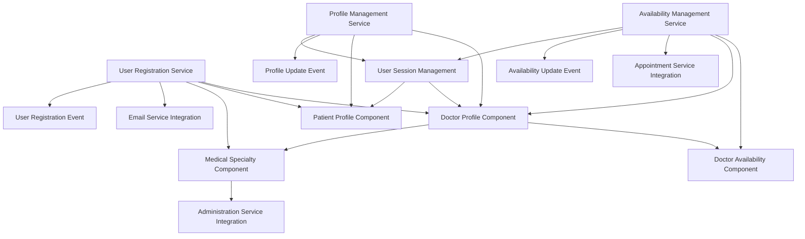
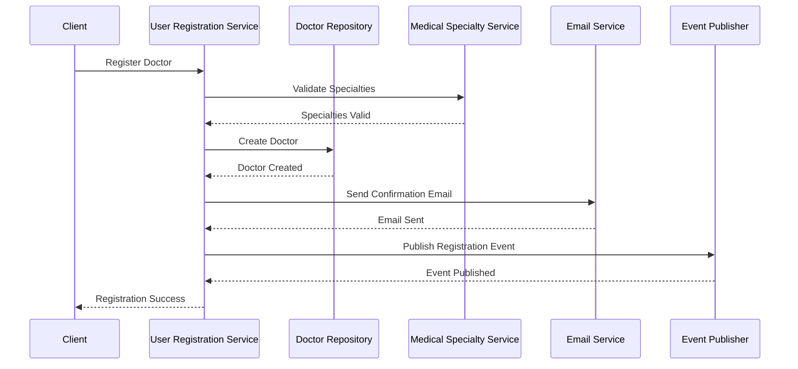

# User Management Service - Domain Model

## Overview
This document defines the comprehensive domain model for the User Management Service of the Doctor Appointment Platform. The model includes all components, attributes, behaviors, and interactions needed to implement the business logic for doctor and patient registration, profile management, and doctor availability management based on the user stories defined in the User Management Service specification.

## Core Entity Components

### Doctor Profile Component

#### Attributes
```
Doctor {
  // Identity
  id: UUID (Primary Key)
  
  // Basic Information
  name: String (required, max 100 chars)
  email: String (required, unique, email format)
  phone: String (required, phone format)
  location: String (required, max 200 chars)
  
  // Professional Information
  specialties: List<UUID> (required, min 1, references MedicalSpecialty)
  experience: String (required, max 1000 chars)
  rating: Decimal (0.0-5.0, default 0.0)
  
  // System Fields
  status: Enum (active, inactive, suspended)
  created_at: DateTime (auto-generated)
  updated_at: DateTime (auto-updated)
  created_by: UUID (system/admin user)
  updated_by: UUID (system/admin user)
}
```

#### Behaviors (CRUD Operations)
```
// Create
+ create(doctorData: DoctorCreateRequest): Doctor

// Read
+ findById(id: UUID): Doctor
+ findByEmail(email: String): Doctor
+ findBySpecialty(specialtyId: UUID): List<Doctor>
+ findAll(): List<Doctor>

// Update
+ update(id: UUID, updates: DoctorUpdateRequest): Doctor
+ updateStatus(id: UUID, status: DoctorStatus): Doctor

// Delete
+ delete(id: UUID): void

// Validation Rules
+ validateEmail(email: String): Boolean
+ validatePhone(phone: String): Boolean
+ validateSpecialties(specialties: List<UUID>): Boolean
```

#### Relationships
- One-to-Many: Doctor → DoctorAvailability
- One-to-Many: Doctor → Appointment
- Many-to-Many: Doctor ↔ MedicalSpecialty

#### User Management Service Specific Behaviors
```
// Registration specific
+ registerDoctor(registrationData: DoctorRegistrationRequest): Doctor
+ validateRegistrationData(registrationData: DoctorRegistrationRequest): ValidationResult

// Profile management specific
+ updateProfile(id: UUID, profileData: DoctorProfileUpdateRequest): Doctor
+ getProfileForUpdate(id: UUID): DoctorProfileView
```

### Patient Profile Component

#### Attributes
```
Patient {
  // Identity
  id: UUID (Primary Key)
  
  // Basic Information
  name: String (required, max 100 chars)
  email: String (required, unique, email format)
  phone: String (required, phone format)
  
  // Medical Information
  medical_history: String (max 2000 chars)
  emergency_contact_name: String (required, max 100 chars)
  emergency_contact_phone: String (required, phone format)
  emergency_contact_relationship: String (required, max 50 chars)
  
  // System Fields
  status: Enum (active, inactive, suspended)
  created_at: DateTime (auto-generated)
  updated_at: DateTime (auto-updated)
  created_by: UUID (system/admin user)
  updated_by: UUID (system/admin user)
}
```

#### Behaviors (CRUD Operations)
```
// Create
+ create(patientData: PatientCreateRequest): Patient

// Read
+ findById(id: UUID): Patient
+ findByEmail(email: String): Patient
+ findAll(): List<Patient>

// Update
+ update(id: UUID, updates: PatientUpdateRequest): Patient
+ updateStatus(id: UUID, status: PatientStatus): Patient

// Delete
+ delete(id: UUID): void

// Validation Rules
+ validateEmail(email: String): Boolean
+ validatePhone(phone: String): Boolean
+ validateEmergencyContact(name: String, phone: String, relationship: String): Boolean
```

#### Relationships
- One-to-Many: Patient → Appointment

#### User Management Service Specific Behaviors
```
// Registration specific
+ registerPatient(registrationData: PatientRegistrationRequest): Patient
+ validateRegistrationData(registrationData: PatientRegistrationRequest): ValidationResult

// Profile management specific
+ updateProfile(id: UUID, profileData: PatientProfileUpdateRequest): Patient
+ getProfileForUpdate(id: UUID): PatientProfileView
```### M
edical Specialty Component

#### Attributes
```
MedicalSpecialty {
  // Identity
  id: UUID (Primary Key)
  
  // Basic Information
  name: String (required, unique, max 100 chars)
  description: String (max 500 chars)
  
  // System Fields
  status: Enum (active, inactive)
  created_at: DateTime (auto-generated)
  updated_at: DateTime (auto-updated)
  created_by: UUID (admin user)
  updated_by: UUID (admin user)
}
```

#### Behaviors (CRUD Operations)
```
// Create
+ create(specialtyData: SpecialtyCreateRequest): MedicalSpecialty

// Read
+ findById(id: UUID): MedicalSpecialty
+ findByName(name: String): MedicalSpecialty
+ findAll(): List<MedicalSpecialty>
+ findActive(): List<MedicalSpecialty>

// Update
+ update(id: UUID, updates: SpecialtyUpdateRequest): MedicalSpecialty
+ updateStatus(id: UUID, status: SpecialtyStatus): MedicalSpecialty

// Delete
+ delete(id: UUID): void

// Validation Rules
+ validateName(name: String): Boolean
+ validateDescription(description: String): Boolean
```

#### Relationships
- Many-to-Many: MedicalSpecialty ↔ Doctor

#### User Management Service Specific Behaviors
```
// Integration with Administration Service
+ fetchActiveSpecialtiesFromAdminService(): List<MedicalSpecialty>
+ validateSpecialtyExists(specialtyId: UUID): Boolean
+ getSpecialtyDetails(specialtyIds: List<UUID>): List<MedicalSpecialty>
```###
 Doctor Availability Component

#### Attributes
```
DoctorAvailability {
  // Identity
  id: UUID (Primary Key)
  doctor_id: UUID (Foreign Key, required)
  
  // Scheduling Information
  datetime: DateTime (required, future date)
  appointment_type: Enum (telemedicine, in_person)
  specialty_id: UUID (Foreign Key to MedicalSpecialty)
  
  // Status Management
  status: Enum (available, booked, blocked)
  
  // System Fields
  created_at: DateTime (auto-generated)
  updated_at: DateTime (auto-updated)
  created_by: UUID (system/admin user)
  updated_by: UUID (system/admin user)
}
```

#### Behaviors (CRUD Operations)
```
// Create
+ create(availabilityData: AvailabilityCreateRequest): DoctorAvailability

// Read
+ findById(id: UUID): DoctorAvailability
+ findByDoctor(doctorId: UUID): List<DoctorAvailability>
+ findByDateRange(start: DateTime, end: DateTime): List<DoctorAvailability>
+ findAvailable(doctorId: UUID, start: DateTime, end: DateTime): List<DoctorAvailability>

// Update
+ update(id: UUID, updates: AvailabilityUpdateRequest): DoctorAvailability
+ updateStatus(id: UUID, status: AvailabilityStatus): DoctorAvailability

// Delete
+ delete(id: UUID): void

// Validation Rules
+ validateDateTime(datetime: DateTime): Boolean
+ validateSpecialty(specialtyId: UUID): Boolean
+ validateBookingWindow(datetime: DateTime): Boolean
```

#### Relationships
- Many-to-One: DoctorAvailability → Doctor
- Many-to-One: DoctorAvailability → MedicalSpecialty
- One-to-One: DoctorAvailability → Appointment (when booked)

#### User Management Service Specific Behaviors
```
// Availability management specific
+ addTimeSlot(doctorId: UUID, slotData: TimeSlotRequest): DoctorAvailability
+ removeTimeSlot(doctorId: UUID, slotId: UUID): void
+ modifyTimeSlot(doctorId: UUID, slotId: UUID, updates: TimeSlotUpdateRequest): DoctorAvailability
+ validateNoConflictWithAppointments(doctorId: UUID, datetime: DateTime): Boolean
+ getDoctorSchedule(doctorId: UUID, startDate: DateTime, endDate: DateTime): List<DoctorAvailability>
```

## Service-Specific Components### User Reg
istration Service Component

#### Attributes
```
UserRegistrationService {
  // Service Configuration
  service_name: String (constant: "user-registration")
  max_registration_attempts: Integer (default: 3)
  email_verification_timeout: Integer (default: 24 hours)
  
  // Dependencies
  doctor_repository: DoctorRepository
  patient_repository: PatientRepository
  email_service: EmailService
  specialty_service: MedicalSpecialtyService
  event_publisher: EventPublisher
}
```

#### Behaviors
```
// Doctor Registration
+ registerDoctor(registrationData: DoctorRegistrationRequest): DoctorRegistrationResult
+ validateDoctorRegistrationData(data: DoctorRegistrationRequest): ValidationResult
+ sendDoctorConfirmationEmail(doctor: Doctor): EmailResult

// Patient Registration  
+ registerPatient(registrationData: PatientRegistrationRequest): PatientRegistrationResult
+ validatePatientRegistrationData(data: PatientRegistrationRequest): ValidationResult
+ sendPatientConfirmationEmail(patient: Patient): EmailResult

// Common Registration Logic
+ checkEmailUniqueness(email: String, userType: UserType): Boolean
+ validateSpecialtySelection(specialtyIds: List<UUID>): ValidationResult
+ publishRegistrationEvent(user: User, userType: UserType): void
+ handleRegistrationFailure(error: RegistrationError): void
```

#### Registration Request Models
```
DoctorRegistrationRequest {
  name: String (required, max 100 chars)
  email: String (required, email format)
  phone: String (required, phone format)
  location: String (required, max 200 chars)
  specialties: List<UUID> (required, min 1)
  experience: String (required, max 1000 chars)
}

PatientRegistrationRequest {
  name: String (required, max 100 chars)
  email: String (required, email format)
  phone: String (required, phone format)
  medical_history: String (optional, max 2000 chars)
  emergency_contact_name: String (required, max 100 chars)
  emergency_contact_phone: String (required, phone format)
  emergency_contact_relationship: String (required, max 50 chars)
}
```### 
Profile Management Service Component

#### Attributes
```
ProfileManagementService {
  // Service Configuration
  service_name: String (constant: "profile-management")
  profile_update_timeout: Integer (default: 30 seconds)
  
  // Dependencies
  doctor_repository: DoctorRepository
  patient_repository: PatientRepository
  specialty_service: MedicalSpecialtyService
  event_publisher: EventPublisher
  session_manager: UserSessionManager
}
```

#### Behaviors
```
// Doctor Profile Management
+ getDoctorProfile(doctorId: UUID): DoctorProfileView
+ updateDoctorProfile(doctorId: UUID, updates: DoctorProfileUpdateRequest): Doctor
+ validateDoctorProfileUpdate(updates: DoctorProfileUpdateRequest): ValidationResult

// Patient Profile Management
+ getPatientProfile(patientId: UUID): PatientProfileView
+ updatePatientProfile(patientId: UUID, updates: PatientProfileUpdateRequest): Patient
+ validatePatientProfileUpdate(updates: PatientProfileUpdateRequest): ValidationResult

// Common Profile Logic
+ publishProfileUpdateEvent(user: User, userType: UserType, changes: ProfileChanges): void
+ trackProfileChanges(before: User, after: User): ProfileChanges
+ validateProfilePermissions(userId: UUID, requesterId: UUID): Boolean
```

#### Profile Update Request Models
```
DoctorProfileUpdateRequest {
  name: String (optional, max 100 chars)
  email: String (optional, email format)
  phone: String (optional, phone format)
  location: String (optional, max 200 chars)
  specialties: List<UUID> (optional, min 1)
  experience: String (optional, max 1000 chars)
}

PatientProfileUpdateRequest {
  name: String (optional, max 100 chars)
  email: String (optional, email format)
  phone: String (optional, phone format)
  medical_history: String (optional, max 2000 chars)
  emergency_contact_name: String (optional, max 100 chars)
  emergency_contact_phone: String (optional, phone format)
  emergency_contact_relationship: String (optional, max 50 chars)
}
```#
## Availability Management Service Component

#### Attributes
```
AvailabilityManagementService {
  // Service Configuration
  service_name: String (constant: "availability-management")
  max_booking_window_days: Integer (default: 30)
  slot_duration_hours: Integer (default: 1)
  
  // Dependencies
  availability_repository: DoctorAvailabilityRepository
  doctor_repository: DoctorRepository
  appointment_service: AppointmentService (for conflict validation)
  event_publisher: EventPublisher
  session_manager: UserSessionManager
}
```

#### Behaviors
```
// Time Slot Management
+ addTimeSlot(doctorId: UUID, slotRequest: TimeSlotRequest): DoctorAvailability
+ removeTimeSlot(doctorId: UUID, slotId: UUID): void
+ modifyTimeSlot(doctorId: UUID, slotId: UUID, updates: TimeSlotUpdateRequest): DoctorAvailability
+ getDoctorAvailability(doctorId: UUID, startDate: DateTime, endDate: DateTime): List<DoctorAvailability>

// Validation and Business Rules
+ validateTimeSlotRequest(slotRequest: TimeSlotRequest): ValidationResult
+ validateBookingWindow(datetime: DateTime): Boolean
+ validateNoAppointmentConflict(doctorId: UUID, datetime: DateTime): Boolean
+ validateSlotModificationPermissions(doctorId: UUID, slotId: UUID): Boolean

// Event Publishing
+ publishAvailabilityUpdateEvent(doctorId: UUID, changes: AvailabilityChanges): void
+ trackAvailabilityChanges(before: DoctorAvailability, after: DoctorAvailability): AvailabilityChanges
```

#### Availability Request Models
```
TimeSlotRequest {
  datetime: DateTime (required, future date within 30 days)
  appointment_type: Enum (telemedicine, in_person)
  specialty_id: UUID (required, must be doctor's specialty)
}

TimeSlotUpdateRequest {
  appointment_type: Enum (optional: telemedicine, in_person)
  specialty_id: UUID (optional, must be doctor's specialty)
}
```### U
ser Session Management Component

#### Attributes
```
UserSession {
  // Identity
  session_id: UUID (Primary Key)
  user_id: UUID (required)
  user_type: Enum (doctor, patient)
  
  // Session Information
  created_at: DateTime (auto-generated)
  last_accessed: DateTime (auto-updated)
  expires_at: DateTime (required)
  ip_address: String (optional)
  user_agent: String (optional)
  
  // Session Status
  status: Enum (active, expired, terminated)
  
  // Session Data
  session_data: String (JSON format, encrypted)
}
```

#### Behaviors
```
// Session Management
+ createSession(userId: UUID, userType: UserType, sessionData: SessionData): UserSession
+ getSession(sessionId: UUID): UserSession
+ updateSessionAccess(sessionId: UUID): UserSession
+ terminateSession(sessionId: UUID): void
+ cleanupExpiredSessions(): Integer

// Session Validation
+ validateSession(sessionId: UUID): SessionValidationResult
+ isSessionActive(sessionId: UUID): Boolean
+ refreshSession(sessionId: UUID): UserSession

// User Context
+ getUserFromSession(sessionId: UUID): User
+ getUserPermissions(sessionId: UUID): List<Permission>
```

#### Session Models
```
SessionData {
  user_name: String
  user_email: String
  permissions: List<String>
  preferences: Map<String, String>
}

SessionValidationResult {
  is_valid: Boolean
  user_id: UUID
  user_type: UserType
  error_message: String (nullable)
}
```

## Integration and Event Components##
# User Registration Event Component

#### Attributes
```
UserRegistrationEvent {
  // Event Identity
  event_id: UUID (Primary Key)
  event_type: String (constant: "user_registered")
  
  // User Information
  user_id: UUID (required)
  user_type: Enum (doctor, patient)
  email: String (required)
  name: String (required)
  
  // Event Metadata
  timestamp: DateTime (auto-generated)
  source_service: String (required)
  correlation_id: UUID (for tracing)
  
  // Processing Status
  status: Enum (pending, processed, failed)
  processed_at: DateTime (nullable)
  error_message: String (nullable)
  
  // System Fields
  created_at: DateTime (auto-generated)
  updated_at: DateTime (auto-updated)
}
```

#### Behaviors (CRUD Operations)
```
// Create
+ create(eventData: UserRegistrationEventRequest): UserRegistrationEvent

// Read
+ findById(eventId: UUID): UserRegistrationEvent
+ findByUserId(userId: UUID): List<UserRegistrationEvent>
+ findByStatus(status: EventStatus): List<UserRegistrationEvent>
+ findPending(): List<UserRegistrationEvent>

// Update
+ update(eventId: UUID, updates: EventUpdateRequest): UserRegistrationEvent
+ updateStatus(eventId: UUID, status: EventStatus): UserRegistrationEvent

// Delete
+ delete(eventId: UUID): void
```###
 Profile Update Event Component

#### Attributes
```
ProfileUpdateEvent {
  // Event Identity
  event_id: UUID (Primary Key)
  event_type: String (constant: "profile_updated")
  
  // User Information
  user_id: UUID (required)
  user_type: Enum (doctor, patient)
  
  // Change Information
  changed_fields: List<String> (fields that were modified)
  previous_values: String (JSON format, previous field values)
  new_values: String (JSON format, new field values)
  
  // Event Metadata
  timestamp: DateTime (auto-generated)
  source_service: String (required)
  correlation_id: UUID (for tracing)
  updated_by: UUID (user who made the change)
  
  // Processing Status
  status: Enum (pending, processed, failed)
  processed_at: DateTime (nullable)
  error_message: String (nullable)
  
  // System Fields
  created_at: DateTime (auto-generated)
  updated_at: DateTime (auto-updated)
}
```

#### Behaviors (CRUD Operations)
```
// Create
+ create(eventData: ProfileUpdateEventRequest): ProfileUpdateEvent

// Read
+ findById(eventId: UUID): ProfileUpdateEvent
+ findByUserId(userId: UUID): List<ProfileUpdateEvent>
+ findByStatus(status: EventStatus): List<ProfileUpdateEvent>
+ findByField(fieldName: String): List<ProfileUpdateEvent>
+ findPending(): List<ProfileUpdateEvent>

// Update
+ update(eventId: UUID, updates: EventUpdateRequest): ProfileUpdateEvent
+ updateStatus(eventId: UUID, status: EventStatus): ProfileUpdateEvent

// Delete
+ delete(eventId: UUID): void
```### A
vailability Update Event Component

#### Attributes
```
AvailabilityUpdateEvent {
  // Event Identity
  event_id: UUID (Primary Key)
  event_type: String (constant: "availability_updated")
  
  // Doctor and Availability Information
  doctor_id: UUID (required)
  availability_id: UUID (required)
  
  // Change Information
  change_type: Enum (added, modified, removed)
  previous_availability: String (JSON format, nullable for additions)
  new_availability: String (JSON format, nullable for removals)
  
  // Event Metadata
  timestamp: DateTime (auto-generated)
  source_service: String (required)
  correlation_id: UUID (for tracing)
  updated_by: UUID (doctor who made the change)
  
  // Processing Status
  status: Enum (pending, processed, failed)
  processed_at: DateTime (nullable)
  error_message: String (nullable)
  
  // System Fields
  created_at: DateTime (auto-generated)
  updated_at: DateTime (auto-updated)
}
```

#### Behaviors (CRUD Operations)
```
// Create
+ create(eventData: AvailabilityUpdateEventRequest): AvailabilityUpdateEvent

// Read
+ findById(eventId: UUID): AvailabilityUpdateEvent
+ findByDoctorId(doctorId: UUID): List<AvailabilityUpdateEvent>
+ findByAvailabilityId(availabilityId: UUID): List<AvailabilityUpdateEvent>
+ findByChangeType(changeType: ChangeType): List<AvailabilityUpdateEvent>
+ findByStatus(status: EventStatus): List<AvailabilityUpdateEvent>
+ findPending(): List<AvailabilityUpdateEvent>

// Update
+ update(eventId: UUID, updates: EventUpdateRequest): AvailabilityUpdateEvent
+ updateStatus(eventId: UUID, status: EventStatus): AvailabilityUpdateEvent

// Delete
+ delete(eventId: UUID): void
```##
# Integration Service Interfaces

#### Email Service Integration Component

#### Attributes
```
EmailServiceIntegration {
  // Service Configuration
  service_name: String (constant: "email-service")
  smtp_server: String
  smtp_port: Integer
  sender_email: String
  
  // Template Configuration
  registration_template_path: String
  confirmation_template_path: String
}
```

#### Behaviors
```
// Email Operations
+ sendRegistrationConfirmation(user: User, userType: UserType): EmailResult
+ sendProfileUpdateNotification(user: User, changes: ProfileChanges): EmailResult
+ validateEmailConfiguration(): Boolean

// Template Management
+ loadEmailTemplate(templateName: String): EmailTemplate
+ renderTemplate(template: EmailTemplate, data: Map<String, Object>): String
```

#### Administration Service Integration Component

#### Attributes
```
AdministrationServiceIntegration {
  // Service Configuration
  service_name: String (constant: "administration-service")
  base_url: String
  api_key: String
  timeout_seconds: Integer (default: 30)
}
```

#### Behaviors
```
// Medical Specialties Integration
+ fetchActiveSpecialties(): List<MedicalSpecialty>
+ validateSpecialtyExists(specialtyId: UUID): Boolean
+ getSpecialtyDetails(specialtyIds: List<UUID>): List<MedicalSpecialty>

// User Data Reporting
+ reportUserRegistration(user: User, userType: UserType): void
+ reportProfileUpdate(user: User, changes: ProfileChanges): void
```

#### Appointment Service Integration Component

#### Attributes
```
AppointmentServiceIntegration {
  // Service Configuration
  service_name: String (constant: "appointment-service")
  base_url: String
  api_key: String
  timeout_seconds: Integer (default: 30)
}
```

#### Behaviors
```
// Appointment Conflict Validation
+ checkAppointmentConflicts(doctorId: UUID, datetime: DateTime): ConflictCheckResult
+ getDoctorAppointments(doctorId: UUID, startDate: DateTime, endDate: DateTime): List<Appointment>

// Availability Synchronization
+ notifyAvailabilityChange(doctorId: UUID, availabilityChange: AvailabilityChange): void
```

## Validation and Business Rules###
 Doctor Registration Validation Rules

#### Required Field Validation
```
DoctorRegistrationValidator {
  // Basic Information Validation
  + validateName(name: String): ValidationResult
    - Must not be null or empty
    - Must be between 2 and 100 characters
    - Must contain only letters, spaces, hyphens, and apostrophes
    
  + validateEmail(email: String): ValidationResult
    - Must not be null or empty
    - Must be valid email format
    - Must be unique across all doctors and patients
    - Must not exceed 255 characters
    
  + validatePhone(phone: String): ValidationResult
    - Must not be null or empty
    - Must be valid phone number format
    - Must be between 10 and 15 digits
    
  + validateLocation(location: String): ValidationResult
    - Must not be null or empty
    - Must be between 5 and 200 characters
    - Must contain valid address components
    
  // Professional Information Validation
  + validateSpecialties(specialties: List<UUID>): ValidationResult
    - Must not be null or empty
    - Must contain at least 1 specialty
    - Must not exceed 10 specialties
    - All specialty IDs must exist in Administration Service
    - All specialties must be active
    
  + validateExperience(experience: String): ValidationResult
    - Must not be null or empty
    - Must be between 10 and 1000 characters
    - Must contain meaningful professional experience description
}
```

#### Business Rule Validation
```
DoctorRegistrationBusinessRules {
  + validateUniqueEmail(email: String): ValidationResult
    - Email must not exist in doctors table
    - Email must not exist in patients table
    
  + validateSpecialtyAvailability(specialties: List<UUID>): ValidationResult
    - All specialties must be currently active
    - Specialties must be available for new registrations
    
  + validateRegistrationLimits(): ValidationResult
    - Check if registration is currently open
    - Validate against daily registration limits
}
```### P
atient Registration Validation Rules

#### Required Field Validation
```
PatientRegistrationValidator {
  // Basic Information Validation
  + validateName(name: String): ValidationResult
    - Must not be null or empty
    - Must be between 2 and 100 characters
    - Must contain only letters, spaces, hyphens, and apostrophes
    
  + validateEmail(email: String): ValidationResult
    - Must not be null or empty
    - Must be valid email format
    - Must be unique across all doctors and patients
    - Must not exceed 255 characters
    
  + validatePhone(phone: String): ValidationResult
    - Must not be null or empty
    - Must be valid phone number format
    - Must be between 10 and 15 digits
    
  // Medical Information Validation
  + validateMedicalHistory(medicalHistory: String): ValidationResult
    - Optional field
    - If provided, must not exceed 2000 characters
    - Must not contain sensitive personal identifiers
    
  // Emergency Contact Validation
  + validateEmergencyContactName(name: String): ValidationResult
    - Must not be null or empty
    - Must be between 2 and 100 characters
    - Must contain only letters, spaces, hyphens, and apostrophes
    
  + validateEmergencyContactPhone(phone: String): ValidationResult
    - Must not be null or empty
    - Must be valid phone number format
    - Must be between 10 and 15 digits
    - Must be different from patient's phone number
    
  + validateEmergencyContactRelationship(relationship: String): ValidationResult
    - Must not be null or empty
    - Must be between 2 and 50 characters
    - Must be from predefined list of relationships (spouse, parent, child, sibling, friend, other)
}
```

#### Business Rule Validation
```
PatientRegistrationBusinessRules {
  + validateUniqueEmail(email: String): ValidationResult
    - Email must not exist in patients table
    - Email must not exist in doctors table
    
  + validateEmergencyContactUniqueness(patientPhone: String, emergencyPhone: String): ValidationResult
    - Emergency contact phone must be different from patient phone
    
  + validateRegistrationLimits(): ValidationResult
    - Check if registration is currently open
    - Validate against daily registration limits
}
```##
# Profile Update Validation Rules

#### Doctor Profile Update Validation
```
DoctorProfileUpdateValidator {
  + validateProfileUpdateRequest(updates: DoctorProfileUpdateRequest, currentDoctor: Doctor): ValidationResult
    - At least one field must be provided for update
    - All provided fields must pass individual validation
    - Email uniqueness must be maintained if email is being updated
    - Specialty changes must be validated against active specialties
    
  + validateEmailUpdate(newEmail: String, currentEmail: String): ValidationResult
    - If email is being changed, new email must be unique
    - New email must be different from current email
    - Must pass standard email validation
    
  + validateSpecialtyUpdate(newSpecialties: List<UUID>, currentSpecialties: List<UUID>): ValidationResult
    - All new specialties must exist and be active
    - Must maintain at least one specialty
    - Cannot exceed maximum specialty limit (10)
    
  + validateExperienceUpdate(newExperience: String): ValidationResult
    - Must be between 10 and 1000 characters if provided
    - Must contain meaningful professional experience description
}
```

#### Patient Profile Update Validation
```
PatientProfileUpdateValidator {
  + validateProfileUpdateRequest(updates: PatientProfileUpdateRequest, currentPatient: Patient): ValidationResult
    - At least one field must be provided for update
    - All provided fields must pass individual validation
    - Email uniqueness must be maintained if email is being updated
    
  + validateEmailUpdate(newEmail: String, currentEmail: String): ValidationResult
    - If email is being changed, new email must be unique
    - New email must be different from current email
    - Must pass standard email validation
    
  + validateEmergencyContactUpdate(updates: PatientProfileUpdateRequest): ValidationResult
    - If any emergency contact field is updated, all emergency contact fields must be valid
    - Emergency contact phone must be different from patient phone
    - Emergency contact relationship must be from predefined list
}
```

#### Common Profile Update Rules
```
ProfileUpdateBusinessRules {
  + validateUpdatePermissions(userId: UUID, requesterId: UUID): ValidationResult
    - Users can only update their own profiles
    - Admin users can update any profile with proper authorization
    
  + validateUpdateFrequency(userId: UUID): ValidationResult
    - Limit profile updates to prevent abuse
    - Maximum 5 updates per day per user
    
  + validateCriticalFieldChanges(changes: ProfileChanges): ValidationResult
    - Email changes require additional verification
    - Phone number changes require confirmation
}
```### Availa
bility Management Validation Rules

#### Time Slot Creation Validation
```
TimeSlotCreationValidator {
  + validateTimeSlotRequest(request: TimeSlotRequest, doctorId: UUID): ValidationResult
    - DateTime must be in the future
    - DateTime must be within 30-day booking window
    - DateTime must be on the hour (no minutes/seconds)
    - Appointment type must be valid (telemedicine or in_person)
    - Specialty must be one of doctor's specialties
    
  + validateBookingWindow(datetime: DateTime): ValidationResult
    - Must be at least 1 hour in the future
    - Must not be more than 30 days in the future
    - Must be during reasonable hours (6 AM - 11 PM)
    
  + validateSpecialtyAssignment(specialtyId: UUID, doctorSpecialties: List<UUID>): ValidationResult
    - Specialty must be in doctor's specialty list
    - Specialty must be active
    
  + validateTimeSlotConflicts(doctorId: UUID, datetime: DateTime): ValidationResult
    - No existing availability slot at the same time
    - No existing appointment at the same time
    - Doctor must not have blocked time at that slot
}
```

#### Time Slot Modification Validation
```
TimeSlotModificationValidator {
  + validateSlotModification(slotId: UUID, updates: TimeSlotUpdateRequest, doctorId: UUID): ValidationResult
    - Slot must exist and belong to the doctor
    - Slot must not be booked (status = available)
    - Only appointment type and specialty can be modified
    - New specialty must be in doctor's specialty list
    
  + validateSlotDeletion(slotId: UUID, doctorId: UUID): ValidationResult
    - Slot must exist and belong to the doctor
    - Slot must not be booked (status = available)
    - Cannot delete slots less than 24 hours in advance
    
  + validateModificationPermissions(slotId: UUID, doctorId: UUID): ValidationResult
    - Only the slot owner (doctor) can modify their slots
    - Admin users can modify with proper authorization
}
```

#### Business Rules for Availability
```
AvailabilityBusinessRules {
  + validateDailySlotLimits(doctorId: UUID, date: Date): ValidationResult
    - Maximum 12 slots per day per doctor
    - Minimum 1-hour gap between consecutive slots
    
  + validateWeeklySlotLimits(doctorId: UUID, weekStart: Date): ValidationResult
    - Maximum 60 slots per week per doctor
    - At least 1 day off per week recommended
    
  + validateAppointmentConflicts(doctorId: UUID, datetime: DateTime): ValidationResult
    - Check with Appointment Service for existing bookings
    - Validate against blocked time periods
    - Ensure no double-booking scenarios
}
```##
# User Status Management Business Rules

#### Status Transition Rules
```
UserStatusBusinessRules {
  // Doctor Status Management
  + validateDoctorStatusTransition(currentStatus: DoctorStatus, newStatus: DoctorStatus): ValidationResult
    - active ↔ inactive (bidirectional)
    - active → suspended (unidirectional, requires admin action)
    - inactive → suspended (unidirectional, requires admin action)
    - suspended → active (requires admin approval)
    - suspended → inactive (requires admin approval)
    
  // Patient Status Management  
  + validatePatientStatusTransition(currentStatus: PatientStatus, newStatus: PatientStatus): ValidationResult
    - active ↔ inactive (bidirectional)
    - active → suspended (unidirectional, requires admin action)
    - inactive → suspended (unidirectional, requires admin action)
    - suspended → active (requires admin approval)
    - suspended → inactive (requires admin approval)
    
  // Status Change Authorization
  + validateStatusChangePermissions(userId: UUID, requesterId: UUID, newStatus: UserStatus): ValidationResult
    - Users can deactivate their own accounts (active → inactive)
    - Users cannot reactivate suspended accounts
    - Only admin users can suspend accounts
    - Only admin users can reactivate suspended accounts
}
```

#### Status Impact Rules
```
UserStatusImpactRules {
  + validateDoctorStatusImpact(doctorId: UUID, newStatus: DoctorStatus): ValidationResult
    - Inactive doctors cannot create new availability slots
    - Suspended doctors have all future availability slots blocked
    - Status changes affect existing appointments based on timing
    
  + validatePatientStatusImpact(patientId: UUID, newStatus: PatientStatus): ValidationResult
    - Inactive patients cannot book new appointments
    - Suspended patients have all future appointments cancelled
    - Status changes require notification to affected doctors
    
  + validateStatusChangeNotifications(user: User, oldStatus: UserStatus, newStatus: UserStatus): ValidationResult
    - Status changes must trigger appropriate notifications
    - Affected parties (doctors/patients with appointments) must be notified
    - Admin users must be notified of suspicious status changes
}
```

## API and Service Interfaces### Doctor M
anagement Service Interface

#### Doctor Registration API
```
DoctorRegistrationAPI {
  // Registration Endpoints
  + POST /doctors/register
    Request: DoctorRegistrationRequest
    Response: DoctorRegistrationResponse
    Description: Register a new doctor on the platform
    
  + GET /doctors/registration/validate-email/{email}
    Response: EmailValidationResponse
    Description: Check if email is available for registration
    
  + GET /doctors/registration/specialties
    Response: List<MedicalSpecialty>
    Description: Get list of available medical specialties for registration
}
```

#### Doctor Profile Management API
```
DoctorProfileAPI {
  // Profile Management Endpoints
  + GET /doctors/{id}/profile
    Response: DoctorProfileResponse
    Description: Get doctor profile information
    
  + PUT /doctors/{id}/profile
    Request: DoctorProfileUpdateRequest
    Response: DoctorProfileResponse
    Description: Update doctor profile information
    
  + GET /doctors/{id}/profile/view
    Response: DoctorProfileView
    Description: Get doctor profile for editing (includes all editable fields)
}
```

#### Doctor Service Interface
```
DoctorService {
  // Core Operations
  + registerDoctor(request: DoctorRegistrationRequest): ServiceResult<Doctor>
  + getDoctorProfile(doctorId: UUID): ServiceResult<Doctor>
  + updateDoctorProfile(doctorId: UUID, updates: DoctorProfileUpdateRequest): ServiceResult<Doctor>
  + validateDoctorRegistration(request: DoctorRegistrationRequest): ValidationResult
  + validateDoctorProfileUpdate(doctorId: UUID, updates: DoctorProfileUpdateRequest): ValidationResult
  
  // Query Operations
  + findDoctorByEmail(email: String): ServiceResult<Doctor>
  + findDoctorsBySpecialty(specialtyId: UUID): ServiceResult<List<Doctor>>
  + checkEmailAvailability(email: String): Boolean
}
```#
## Patient Management Service Interface

#### Patient Registration API
```
PatientRegistrationAPI {
  // Registration Endpoints
  + POST /patients/register
    Request: PatientRegistrationRequest
    Response: PatientRegistrationResponse
    Description: Register a new patient on the platform
    
  + GET /patients/registration/validate-email/{email}
    Response: EmailValidationResponse
    Description: Check if email is available for registration
}
```

#### Patient Profile Management API
```
PatientProfileAPI {
  // Profile Management Endpoints
  + GET /patients/{id}/profile
    Response: PatientProfileResponse
    Description: Get patient profile information
    
  + PUT /patients/{id}/profile
    Request: PatientProfileUpdateRequest
    Response: PatientProfileResponse
    Description: Update patient profile information
    
  + GET /patients/{id}/profile/view
    Response: PatientProfileView
    Description: Get patient profile for editing (includes all editable fields)
}
```

#### Patient Service Interface
```
PatientService {
  // Core Operations
  + registerPatient(request: PatientRegistrationRequest): ServiceResult<Patient>
  + getPatientProfile(patientId: UUID): ServiceResult<Patient>
  + updatePatientProfile(patientId: UUID, updates: PatientProfileUpdateRequest): ServiceResult<Patient>
  + validatePatientRegistration(request: PatientRegistrationRequest): ValidationResult
  + validatePatientProfileUpdate(patientId: UUID, updates: PatientProfileUpdateRequest): ValidationResult
  
  // Query Operations
  + findPatientByEmail(email: String): ServiceResult<Patient>
  + checkEmailAvailability(email: String): Boolean
  + getPatientBasicInfo(patientId: UUID): ServiceResult<PatientBasicInfo>
}
```### 
Availability Management Service Interface

#### Doctor Availability API
```
DoctorAvailabilityAPI {
  // Availability Management Endpoints
  + POST /doctors/{id}/availability
    Request: TimeSlotRequest
    Response: DoctorAvailabilityResponse
    Description: Add a new time slot for doctor availability
    
  + GET /doctors/{id}/availability
    Query Parameters: start_date, end_date
    Response: List<DoctorAvailabilityResponse>
    Description: Get doctor's availability for a date range
    
  + PUT /doctors/{id}/availability/{slot_id}
    Request: TimeSlotUpdateRequest
    Response: DoctorAvailabilityResponse
    Description: Modify an existing time slot
    
  + DELETE /doctors/{id}/availability/{slot_id}
    Response: SuccessResponse
    Description: Remove an available time slot
    
  + GET /doctors/{id}/available-slots
    Query Parameters: start_date, end_date, specialty_id
    Response: List<AvailableSlotResponse>
    Description: Get available (unbooked) time slots for appointment booking
}
```

#### Availability Service Interface
```
AvailabilityService {
  // Core Operations
  + addTimeSlot(doctorId: UUID, request: TimeSlotRequest): ServiceResult<DoctorAvailability>
  + removeTimeSlot(doctorId: UUID, slotId: UUID): ServiceResult<Void>
  + modifyTimeSlot(doctorId: UUID, slotId: UUID, updates: TimeSlotUpdateRequest): ServiceResult<DoctorAvailability>
  + getDoctorAvailability(doctorId: UUID, startDate: DateTime, endDate: DateTime): ServiceResult<List<DoctorAvailability>>
  
  // Validation Operations
  + validateTimeSlotRequest(doctorId: UUID, request: TimeSlotRequest): ValidationResult
  + validateTimeSlotModification(doctorId: UUID, slotId: UUID, updates: TimeSlotUpdateRequest): ValidationResult
  + validateSlotDeletion(doctorId: UUID, slotId: UUID): ValidationResult
  
  // Query Operations
  + getAvailableSlots(doctorId: UUID, startDate: DateTime, endDate: DateTime): ServiceResult<List<DoctorAvailability>>
  + checkSlotAvailability(doctorId: UUID, datetime: DateTime): Boolean
  + getDoctorSchedule(doctorId: UUID, date: Date): ServiceResult<List<DoctorAvailability>>
}
```### 
External Service Integration Interfaces

#### Query APIs for Other Services
```
UserManagementQueryAPI {
  // Doctor Query Endpoints (for Appointment & Matching Service)
  + GET /doctors/search
    Query Parameters: specialty_id, location, availability_start, availability_end
    Response: List<DoctorSearchResult>
    Description: Search doctors by criteria for appointment matching
    
  + GET /doctors/{id}/available-slots
    Query Parameters: start_date, end_date
    Response: List<AvailableSlotResponse>
    Description: Get doctor's available time slots for appointment booking
    
  // Patient Query Endpoints (for Appointment & Matching Service)
  + GET /patients/{id}/basic-info
    Response: PatientBasicInfoResponse
    Description: Get basic patient information for appointment management
    
  // User Verification Endpoints (for Administration Service)
  + GET /users/verify/{id}
    Query Parameters: user_type (doctor|patient)
    Response: UserVerificationResponse
    Description: Verify user exists and get basic information
}
```

#### Event Publishing Interface
```
EventPublishingService {
  // Event Publishing Operations
  + publishUserRegistrationEvent(user: User, userType: UserType): ServiceResult<Void>
  + publishProfileUpdateEvent(user: User, userType: UserType, changes: ProfileChanges): ServiceResult<Void>
  + publishAvailabilityUpdateEvent(doctorId: UUID, availabilityChange: AvailabilityChange): ServiceResult<Void>
  
  // Event Configuration
  + configureEventPublishing(eventType: EventType, configuration: EventConfiguration): ServiceResult<Void>
  + validateEventPayload(eventType: EventType, payload: Object): ValidationResult
}
```

#### Session Management Interface
```
SessionManagementAPI {
  // Session Management Endpoints
  + POST /sessions
    Request: CreateSessionRequest
    Response: SessionResponse
    Description: Create a new user session
    
  + GET /sessions/{session_id}
    Response: SessionResponse
    Description: Get session information
    
  + PUT /sessions/{session_id}/refresh
    Response: SessionResponse
    Description: Refresh session expiration
    
  + DELETE /sessions/{session_id}
    Response: SuccessResponse
    Description: Terminate user session
    
  + GET /sessions/{session_id}/user
    Response: UserContextResponse
    Description: Get user context from session
}
```

## Error Handling and Edge Cases### 
Registration Error Handling

#### Registration Error Types
```
RegistrationErrorHandler {
  // Validation Errors
  + handleValidationError(error: ValidationError): RegistrationErrorResponse
    - Invalid email format
    - Duplicate email address
    - Invalid phone number format
    - Missing required fields
    - Invalid specialty selection
    - Experience description too short/long
    
  // Business Rule Errors
  + handleBusinessRuleError(error: BusinessRuleError): RegistrationErrorResponse
    - Registration limits exceeded
    - Specialty not available for registration
    - Email already exists in system
    - Invalid emergency contact information
    
  // Integration Errors
  + handleIntegrationError(error: IntegrationError): RegistrationErrorResponse
    - Administration Service unavailable (specialty validation)
    - Email service unavailable (confirmation email)
    - Database connection errors
    - External service timeout
    
  // System Errors
  + handleSystemError(error: SystemError): RegistrationErrorResponse
    - Database write failures
    - Event publishing failures
    - Unexpected system exceptions
    - Resource exhaustion
}
```

#### Registration Error Recovery
```
RegistrationErrorRecovery {
  + retryRegistration(registrationId: UUID, retryCount: Integer): ServiceResult<User>
    - Maximum 3 retry attempts
    - Exponential backoff between retries
    - Different retry strategies for different error types
    
  + rollbackPartialRegistration(registrationId: UUID): ServiceResult<Void>
    - Clean up partially created user records
    - Cancel pending email confirmations
    - Remove temporary session data
    
  + notifyRegistrationFailure(email: String, errorType: ErrorType): ServiceResult<Void>
    - Send failure notification to user
    - Log error for admin investigation
    - Provide recovery instructions
}
```### Profi
le Update Error Handling

#### Profile Update Error Types
```
ProfileUpdateErrorHandler {
  // Validation Errors
  + handleValidationError(error: ValidationError): ProfileUpdateErrorResponse
    - Invalid field values
    - Email uniqueness violations
    - Phone number format errors
    - Specialty validation failures
    - Emergency contact validation errors
    
  // Permission Errors
  + handlePermissionError(error: PermissionError): ProfileUpdateErrorResponse
    - User attempting to update another user's profile
    - Insufficient permissions for field updates
    - Session expired or invalid
    - Account suspended or inactive
    
  // Concurrency Errors
  + handleConcurrencyError(error: ConcurrencyError): ProfileUpdateErrorResponse
    - Profile modified by another session
    - Optimistic locking failures
    - Race conditions in updates
    
  // Integration Errors
  + handleIntegrationError(error: IntegrationError): ProfileUpdateErrorResponse
    - Specialty service unavailable
    - Event publishing failures
    - Database connection issues
}
```

#### Profile Update Error Recovery
```
ProfileUpdateErrorRecovery {
  + retryProfileUpdate(updateId: UUID, retryCount: Integer): ServiceResult<User>
    - Maximum 3 retry attempts for transient errors
    - Reload current profile state before retry
    - Merge conflicting changes where possible
    
  + rollbackProfileUpdate(updateId: UUID, previousState: User): ServiceResult<User>
    - Restore previous profile state
    - Cancel pending event notifications
    - Log rollback for audit trail
    
  + handleConcurrentUpdate(userId: UUID, conflictingChanges: ProfileChanges): ServiceResult<ConflictResolution>
    - Present conflict resolution options to user
    - Allow user to choose which changes to keep
    - Merge non-conflicting changes automatically
}
```### Avai
lability Management Error Handling

#### Availability Error Types
```
AvailabilityErrorHandler {
  // Scheduling Errors
  + handleSchedulingError(error: SchedulingError): AvailabilityErrorResponse
    - Time slot conflicts with existing appointments
    - Invalid time slot (past date, outside booking window)
    - Slot already exists at the same time
    - Doctor not authorized for specialty
    
  // Business Rule Errors
  + handleBusinessRuleError(error: BusinessRuleError): AvailabilityErrorResponse
    - Daily slot limit exceeded
    - Weekly slot limit exceeded
    - Slot modification not allowed (already booked)
    - Insufficient gap between consecutive slots
    
  // Integration Errors
  + handleIntegrationError(error: IntegrationError): AvailabilityErrorResponse
    - Appointment Service unavailable (conflict checking)
    - Event publishing failures
    - Database transaction failures
    
  // Permission Errors
  + handlePermissionError(error: PermissionError): AvailabilityErrorResponse
    - Doctor attempting to modify another doctor's slots
    - Session expired or invalid
    - Account suspended or inactive
}
```

#### Availability Error Recovery
```
AvailabilityErrorRecovery {
  + retryAvailabilityOperation(operationId: UUID, retryCount: Integer): ServiceResult<DoctorAvailability>
    - Maximum 3 retry attempts for transient errors
    - Re-validate slot availability before retry
    - Check for appointment conflicts again
    
  + suggestAlternativeSlots(doctorId: UUID, requestedDateTime: DateTime): ServiceResult<List<DateTime>>
    - Find nearby available time slots
    - Consider doctor's existing schedule
    - Respect business rules and constraints
    
  + handleSlotConflict(doctorId: UUID, conflictingSlot: DoctorAvailability): ServiceResult<ConflictResolution>
    - Identify the source of conflict
    - Provide resolution options
    - Allow slot modification if possible
}
```### Edge Ca
ses and Exception Scenarios

#### Registration Edge Cases
```
RegistrationEdgeCases {
  + handleDuplicateRegistrationAttempt(email: String): ServiceResult<RegistrationResult>
    - User attempts to register with same email multiple times
    - Check if previous registration is complete or pending
    - Allow re-registration if previous attempt failed
    
  + handleIncompleteRegistration(registrationId: UUID): ServiceResult<RegistrationResult>
    - Registration started but not completed
    - Email confirmation pending
    - Cleanup incomplete records after timeout
    
  + handleSpecialtyServiceUnavailable(): ServiceResult<List<MedicalSpecialty>>
    - Administration Service is down during registration
    - Use cached specialty list if available
    - Allow registration with validation deferred
    
  + handleEmailServiceUnavailable(user: User): ServiceResult<Void>
    - Email service is down during registration
    - Queue confirmation email for later delivery
    - Allow registration to complete without immediate email
}
```

#### Profile Management Edge Cases
```
ProfileManagementEdgeCases {
  + handleOrphanedSession(sessionId: UUID): ServiceResult<SessionValidationResult>
    - Session exists but user is deleted
    - Session exists but user is suspended
    - Clean up orphaned session data
    
  + handleCascadingProfileUpdates(userId: UUID, changes: ProfileChanges): ServiceResult<Void>
    - Email change affects multiple systems
    - Specialty change affects existing appointments
    - Coordinate updates across dependent systems
    
  + handleProfileUpdateDuringAppointment(doctorId: UUID, updates: DoctorProfileUpdateRequest): ServiceResult<UpdateResult>
    - Doctor tries to update profile during active appointment
    - Restrict certain updates during appointment hours
    - Queue updates for after appointment completion
}
```

#### Availability Management Edge Cases
```
AvailabilityEdgeCases {
  + handleTimeZoneConflicts(doctorId: UUID, datetime: DateTime): ServiceResult<TimeSlotValidation>
    - Doctor and system in different time zones
    - Daylight saving time transitions
    - Standardize all times to UTC
    
  + handleSlotDeletionWithPendingBooking(slotId: UUID): ServiceResult<DeletionResult>
    - Slot deletion requested while booking is in progress
    - Use optimistic locking to prevent conflicts
    - Notify booking process of slot unavailability
    
  + handleDoctorStatusChangeWithActiveSlots(doctorId: UUID, newStatus: DoctorStatus): ServiceResult<StatusChangeResult>
    - Doctor becomes inactive with future availability slots
    - Doctor is suspended with booked appointments
    - Handle slot cleanup and appointment notifications
    
  + handleSystemClockSkew(requestedDateTime: DateTime): ServiceResult<TimeValidation>
    - Client and server clocks are out of sync
    - Validate times against server time
    - Provide time synchronization guidance
}
```

#### System-Level Edge Cases
```
SystemEdgeCases {
  + handleDatabasePartition(operation: DatabaseOperation): ServiceResult<OperationResult>
    - Database becomes temporarily unavailable
    - Use circuit breaker pattern
    - Queue operations for retry when database recovers
    
  + handleEventPublishingFailure(event: DomainEvent): ServiceResult<Void>
    - Event bus is unavailable
    - Store events locally for later publishing
    - Implement dead letter queue for failed events
    
  + handleCascadingServiceFailures(): ServiceResult<ServiceStatus>
    - Multiple dependent services fail simultaneously
    - Implement graceful degradation
    - Maintain core functionality with reduced features
    
  + handleDataInconsistency(entityId: UUID, entityType: EntityType): ServiceResult<ConsistencyCheck>
    - Data corruption or inconsistency detected
    - Implement data validation and repair procedures
    - Log inconsistencies for manual review
}
```

## Component Relationships and Interactions### C
omponent Relationship Diagram



### Service Interaction Flow



### Data Flow Architecture

```mermaid
flowchart LR
    %% Input Layer
    API[API Layer]
    
    %% Service Layer
    RegService[Registration Service]
    ProfileService[Profile Service]
    AvailService[Availability Service]
    
    %% Domain Layer
    DoctorDomain[Doctor Domain]
    PatientDomain[Patient Domain]
    AvailabilityDomain[Availability Domain]
    
    %% Data Layer
    DoctorRepo[Doctor Repository]
    PatientRepo[Patient Repository]
    AvailabilityRepo[Availability Repository]
    SessionRepo[Session Repository]
    
    %% External Services
    EmailExt[Email Service]
    AdminExt[Admin Service]
    AppointmentExt[Appointment Service]
    
    %% Event Layer
    EventBus[Event Bus]
    
    API --> RegService
    API --> ProfileService
    API --> AvailService
    
    RegService --> DoctorDomain
    RegService --> PatientDomain
    ProfileService --> DoctorDomain
    ProfileService --> PatientDomain
    AvailService --> AvailabilityDomain
    
    DoctorDomain --> DoctorRepo
    PatientDomain --> PatientRepo
    AvailabilityDomain --> AvailabilityRepo
    
    RegService --> EmailExt
    RegService --> AdminExt
    AvailService --> AppointmentExt
    
    RegService --> EventBus
    ProfileService --> EventBus
    AvailService --> EventBus
    
    ProfileService --> SessionRepo
    AvailService --> SessionRepo
```## Bus
iness Rules and Constraints Summary

### Global Business Rules
1. **Email Uniqueness**: Email addresses must be unique across all doctors and patients
2. **Phone Validation**: All phone numbers must be valid and follow international format
3. **Time Zone Standardization**: All datetime values are stored and processed in UTC
4. **Audit Trail**: All user actions must be logged for audit purposes
5. **Data Encryption**: Sensitive data must be encrypted at rest and in transit

### Doctor-Specific Business Rules
1. **Specialty Requirements**: Doctors must have at least 1 and at most 10 medical specialties
2. **Experience Validation**: Experience description must be between 10-1000 characters
3. **Rating Management**: Doctor ratings start at 0.0 and are managed by external systems
4. **Location Requirement**: Location is mandatory for appointment matching purposes
5. **Status Transitions**: Only specific status transitions are allowed (active ↔ inactive ↔ suspended)

### Patient-Specific Business Rules
1. **Emergency Contact**: Emergency contact information is mandatory for all patients
2. **Medical History**: Medical history is optional but recommended for better care
3. **Contact Uniqueness**: Emergency contact phone must be different from patient's phone
4. **Relationship Validation**: Emergency contact relationship must be from predefined list

### Availability Management Business Rules
1. **Booking Window**: Availability can only be set up to 30 days in advance
2. **Time Slot Duration**: All time slots are exactly 1 hour long
3. **Future Dates Only**: Availability can only be set for future dates (minimum 1 hour ahead)
4. **Slot Limits**: Maximum 12 slots per day, 60 slots per week per doctor
5. **Modification Restrictions**: Booked slots cannot be modified or deleted
6. **Specialty Alignment**: Availability slots must be associated with doctor's specialties
7. **Conflict Prevention**: No overlapping slots or appointment conflicts allowed

### Session Management Business Rules
1. **Session Expiration**: Sessions expire after 24 hours of inactivity
2. **Single Session**: Users can have only one active session at a time
3. **Permission Validation**: All operations require valid session and appropriate permissions
4. **Session Cleanup**: Expired sessions are automatically cleaned up daily

### Integration Business Rules
1. **Specialty Synchronization**: Medical specialties are always fetched from Administration Service
2. **Event Publishing**: All significant user actions must publish events for other services
3. **Email Delivery**: Registration confirmations must be sent directly via email service
4. **Appointment Validation**: Availability changes must be validated against existing appointments
5. **Service Timeouts**: External service calls have 30-second timeout limits

### Validation Constraints
1. **Registration Limits**: Maximum 100 registrations per day per IP address
2. **Update Frequency**: Maximum 5 profile updates per day per user
3. **Retry Logic**: Maximum 3 retry attempts for failed operations
4. **Error Recovery**: All operations must have rollback capabilities
5. **Data Consistency**: All database operations must be transactional

### Security Constraints
1. **Permission Checks**: Users can only modify their own profiles
2. **Admin Override**: Admin users can modify any profile with proper authorization
3. **Session Security**: Sessions must include IP address and user agent validation
4. **Data Privacy**: Personal information access is logged and monitored
5. **Account Suspension**: Suspended accounts cannot perform any operations## Use
r Story Validation

### US-D001: Doctor Registration ✅
**Components Covered:**
- Doctor Profile Component (attributes and behaviors)
- User Registration Service Component (registerDoctor method)
- Medical Specialty Component (specialty selection)
- Email Service Integration (confirmation email)
- User Registration Event (event publishing)

**Acceptance Criteria Mapping:**
- ✅ Basic information entry → Doctor Profile attributes (name, email, phone, location)
- ✅ Medical specialty selection → Medical Specialty Component integration
- ✅ Experience details → Doctor Profile experience attribute
- ✅ Initial rating (0) → Doctor Profile rating attribute with default 0.0
- ✅ Confirmation email → Email Service Integration sendRegistrationConfirmation

### US-D002: Doctor Profile Management ✅
**Components Covered:**
- Doctor Profile Component (update behaviors)
- Profile Management Service Component (updateDoctorProfile method)
- Profile Update Event (change tracking)
- Session Management (user authentication)

**Acceptance Criteria Mapping:**
- ✅ Update contact information → DoctorProfileUpdateRequest model
- ✅ Modify specialties → Specialty validation in profile updates
- ✅ Update experience details → Experience field in update request
- ✅ View current rating → Doctor Profile rating attribute (read-only)
- ✅ Immediate saves → Profile Management Service immediate persistence

### US-D003: Set Individual Time Slots ✅
**Components Covered:**
- Doctor Availability Component (attributes and behaviors)
- Availability Management Service Component (addTimeSlot method)
- Time Slot Request Model (slot creation)
- Availability Update Event (change notification)

**Acceptance Criteria Mapping:**
- ✅ Add 1-hour time slots → DoctorAvailability with 1-hour duration constraint
- ✅ Up to one month advance → validateBookingWindow business rule
- ✅ Telemedicine/in-person specification → appointment_type attribute
- ✅ Associate specialties → specialty_id attribute and validation
- ✅ See scheduled appointments → Integration with Appointment Service

### US-D004: Manage Existing Time Slots ✅
**Components Covered:**
- Availability Management Service Component (modifyTimeSlot, removeTimeSlot methods)
- Time Slot Modification Validation (business rules)
- Availability Update Event (change tracking)

**Acceptance Criteria Mapping:**
- ✅ Remove unbooked slots → removeTimeSlot with status validation
- ✅ Modify appointment type → TimeSlotUpdateRequest model
- ✅ Cannot modify booked slots → validateSlotModification business rule
- ✅ View availability calendar → getDoctorAvailability method

### US-P001: Patient Registration ✅
**Components Covered:**
- Patient Profile Component (attributes and behaviors)
- User Registration Service Component (registerPatient method)
- Email Service Integration (confirmation email)
- User Registration Event (event publishing)

**Acceptance Criteria Mapping:**
- ✅ Basic information entry → Patient Profile attributes (name, email, phone)
- ✅ Medical history → medical_history attribute (optional)
- ✅ Emergency contact information → emergency_contact_* attributes
- ✅ Confirmation email → Email Service Integration sendRegistrationConfirmation

### US-P002: Patient Profile Management ✅
**Components Covered:**
- Patient Profile Component (update behaviors)
- Profile Management Service Component (updatePatientProfile method)
- Profile Update Event (change tracking)
- Session Management (user authentication)

**Acceptance Criteria Mapping:**
- ✅ Update contact information → PatientProfileUpdateRequest model
- ✅ Modify medical history → medical_history field in update request
- ✅ Update emergency contact → emergency_contact_* fields in update request
- ✅ Immediate saves → Profile Management Service immediate persistence

## Implementation Coverage Summary

### ✅ Fully Covered User Stories: 6/6
- All user stories have complete domain model coverage
- All acceptance criteria are mapped to specific components
- All business rules and validation logic are defined
- All integration points are specified

### 🔧 Additional Components Created
- Session Management (not in original user stories but required)
- Event Publishing (for service integration)
- Error Handling (for robust operation)
- Validation Framework (for data integrity)

### 📋 Ready for Implementation
The domain model provides a complete foundation for implementing the User Management Service with:
- Clear component boundaries and responsibilities
- Comprehensive validation and business rules
- Well-defined service interfaces and APIs
- Robust error handling and edge case management
- Complete integration specifications with other services

This domain model successfully addresses all user stories and provides the necessary structure for a production-ready User Management Service.